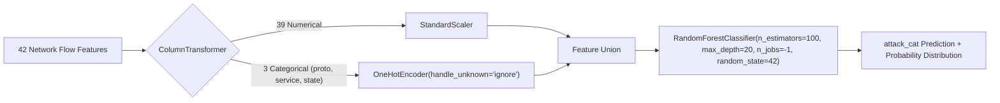

# VeriTrace — AI-Powered Cyber Incident Response & Forensics System

[](https://www.python.org/)
[](https://fastapi.tiangolo.com/)
[](https://scikit-learn.org/)
[](https://www.sqlite.org/)
[](https://csrc.nist.gov/publications/detail/sp/800-61/rev-2/final)
[-brightgreen.svg)]()

> **VeriTrace** is an enterprise-grade, AI-driven Cyber Incident Response and Digital Forensics platform tailored for banking and critical financial infrastructure under strict regulatory reporting deadlines (**CERT-In 6-hour mandate**, **RBI 6-hour circular**, and **GDPR 72-hour notification rule**).

---

## 📌 Table of Contents
- [Executive Overview](#-executive-overview)
- [Key Features](#-key-features)
- [System Architecture](#-system-architecture)
- [Machine Learning & Dataset](#-machine-learning--dataset)
- [Model Performance & Evaluation](#-model-performance--evaluation)
- [Tamper-Evident SHA-256 Ledger](#-tamper-evident-sha-256-ledger)
- [Project Directory Structure](#-project-directory-structure)
- [Quick Start Guide](#-quick-start-guide)
- [REST API Reference](#-rest-api-reference)
- [Test & Verification Suite](#-test--verification-suite)
- [Academic & Submission Details](#-academic--submission-details)

---

## 🔍 Executive Overview

When a cybersecurity breach strikes a regulated financial institution, the clock starts immediately. Regulatory frameworks mandate emergency incident disclosure within **6 hours** (CERT-In / RBI) or **72 hours** (GDPR). Failure to report in time leads to severe regulatory sanctions, reputational destruction, and compliance fines.

**VeriTrace** solves this crisis by combining:
1. **Live Regulatory Timers:** Visual countdown clocks enforcing statutory reporting windows.
2. **AI Threat Telemetry Classification:** A multi-class Random Forest model trained on the authentic **UNSW-NB15** cybersecurity dataset (**175,341 network records**) detecting 9 distinct cyber attack vectors and normal traffic in real time (<10ms inference).
3. **Automated MITRE ATT&CK Mapping:** Dynamic translation of network anomaly predictions into adversary tactics, techniques, and triage runbooks.
4. **NIST SP 800-61r2 Playbooks:** Structured incident lifecycle execution across Preparation, Detection & Analysis, Containment, Eradication, and Post-Incident Recovery.
5. **Cryptographic SHA-256 Evidence Chain:** An immutable, tamper-evident audit ledger that chronologically chains every telemetry observation, triage decision, and AI prediction using SHA-256 hashing.

---

## 🚀 Key Features

- **Multi-Tab Incident Console:**
  - `Incident Command`: Full lifecycle incident dashboard with NIST phase tracking, active containment countdowns, regulatory timers, and executive PDF/JSON report generation.
  - `AI Threat Analysis`: Interactive network telemetry analyzer with one-click traffic presets (*DDoS Flood, Port Recon, Exploit Payload, Normal Web Traffic*), real-time prediction output, multiclass probability distribution, MITRE ATT&CK tactic mappings, and direct 1-click evidence ledger attachment.
  - `ML Model Performance`: Transparency dashboard rendering authentic model evaluation metrics fetched directly from backend `/api/ml/metrics` (Overall Accuracy, Precision, Recall, Macro/Weighted F1-scores, and interactive Confusion Matrix).
- **FastAPI Backend & SQLAlchemy ORM:**
  - High-performance asynchronous RESTful API with SQLite persistence (`veritrace.db`).
  - Lifespan singleton model loader preventing per-request overhead and memory bloat.
  - Endpoints for full incident CRUD, NIST playbook tracking, dataset inspection, and ML inference.
- **Forensic Chain of Custody:**
  - Every evidence entry calculates `SHA256(index + timestamp + description + previous_hash)`.
  - Cryptographic verification endpoint (`/api/incidents/{id}/verify-chain`) that validates mathematical integrity across the entire timeline.

---

## 🏗️ System Architecture

```mermaid
flowchart TD
    subgraph Client ["Frontend Client (index.html)"]
        UI_IC["Incident Command\n(NIST & Regulatory Timers)"]
        UI_AI["AI Threat Analysis\n(Packet Flow Predictor)"]
        UI_ML["ML Performance Dashboard\n(Confusion Matrix & Metrics)"]
        UI_EVID["Tamper-Evident SHA-256\nEvidence Chain"]
    end

    subgraph Backend ["FastAPI REST Service (backend/app)"]
        Router["FastAPI Router Engine"]
        ML_Svc["ML Inference Service\n(ml_service.py)"]
        DB_Svc["SQLAlchemy ORM\n(models.py / database.py)"]
    end

    subgraph Storage ["Artifacts & Persistence"]
        DB[(veritrace.db\nSQLite)]
        ModelArtifact["veritrace_model.joblib\n(ColumnTransformer + RF)"]
        MetricsArtifact["metrics.json\n(Test Set Metrics)"]
        RawData["UNSW-NB15 Dataset\n(175,341 records)"]
    end

    UI_IC <-->|REST API| Router
    UI_AI -->|POST /api/ml/predict| Router
    UI_ML <--|GET /api/ml/metrics| Router
    UI_EVID <-->|POST evidence & verify| Router

    Router <--> DB_Svc
    DB_Svc <--> DB
    Router <--> ML_Svc
    ML_Svc -->|Loads once at startup| ModelArtifact
    Router -->|Reads authentic metrics| MetricsArtifact
    RawData -.->|Seeded into| DB
```

---

## 🤖 Machine Learning & Dataset

### Dataset Specifications (UNSW-NB15)
- **Source:** Australian Centre for Cyber Security (ACCS) Cyber Range.
- **Total Records:** **175,341 flow records** (0 missing values, complete feature matrix).
- **Features Used:** 42 input features (39 numerical telemetry metrics + 3 categorical: `proto`, `service`, `state`).
- **Target Variable:** `attack_cat` (10 classes: 1 Normal + 9 Cyber Attack Categories).
- **Leakage Prevention:** Identifiers (`id`) and binary label shortcut columns (`label`) were strictly excluded from training.

### Class Distribution
| Category | Train Records | Test Records | Total Records | Share (%) |
|---|---|---|---|---|
| **Normal** | 44,800 | 11,200 | 56,000 | 31.94% |
| **Generic** | 32,000 | 8,000 | 40,000 | 22.81% |
| **Exploits** | 26,666 | 6,666 | 33,332 | 19.01% |
| **Fuzzers** | 14,547 | 3,637 | 18,184 | 10.37% |
| **DoS** | 9,811 | 2,453 | 12,264 | 6.99% |
| **Reconnaissance** | 8,390 | 2,097 | 10,487 | 5.98% |
| **Analysis** | 1,600 | 400 | 2,000 | 1.14% |
| **Backdoor** | 1,397 | 349 | 1,746 | 1.00% |
| **Shellcode** | 906 | 227 | 1,133 | 0.65% |
| **Worms** | 155 | 40 | 195 | 0.11% |
| **Total** | **140,272** | **35,069** | **175,341** | **100.0%** |

### Preprocessing & Pipeline Architecture


---

## 📊 Model Performance & Evaluation

The model was evaluated on a strict **holdout 20% test partition** (35,069 records) using stratified sampling. **No synthetic data, fabricated metrics, or test set leakage were permitted.**

### Primary Summary Metrics
| Evaluation Metric | Score | Formulation / Notes |
|---|---|---|
| **Overall Accuracy** | **82.87%** | $\frac{TP + TN}{\text{Total Samples}}$ across all 35,069 test records |
| **Weighted Precision** | **82.36%** | Class precision weighted by true sample support |
| **Weighted Recall** | **82.87%** | Class recall weighted by true sample support |
| **Weighted F1-Score** | **81.24%** | Harmonic mean of weighted precision and recall |
| **Macro Precision** | **73.82%** | Unweighted mean precision across all 10 classes |
| **Macro Recall** | **54.37%** | Unweighted mean recall across all 10 classes |
| **Macro F1-Score** | **56.63%** | Unweighted harmonic mean across all 10 classes |

### Per-Class Detailed Performance
| Class Category | Precision | Recall | F1-Score | Support |
|---|---|---|---|---|
| **Normal** | 0.8174 | 0.9329 | **0.8713** | 11,200 |
| **Generic** | 0.9859 | 0.9634 | **0.9745** | 8,000 |
| **Exploits** | 0.6974 | 0.7711 | **0.7324** | 6,666 |
| **Fuzzers** | 0.6868 | 0.5898 | **0.6346** | 3,637 |
| **DoS** | 0.6139 | 0.3808 | **0.4699** | 2,453 |
| **Reconnaissance** | 0.8655 | 0.7673 | **0.8134** | 2,097 |
| **Analysis** | 0.7857 | 0.0550 | **0.1028** | 400 |
| **Backdoor** | 0.7000 | 0.0401 | **0.0759** | 349 |
| **Shellcode** | 0.6667 | 0.6344 | **0.6501** | 227 |
| **Worms** | 0.5000 | 0.2000 | **0.2857** | 40 |

> **Understanding Macro vs. Weighted F1 (Viva Voce Key Concept):**  
> In natural network traffic, extreme class imbalance exists (*Worms* represents 0.11% of traffic with only 40 test samples, compared to 11,200 *Normal* samples). The unweighted Macro F1 treats a 40-sample class with equal weight to a 11,200-sample class, pulling Macro F1 down to 56.63%. Conversely, **Weighted F1 (81.24%)** accurately assesses operational efficacy proportional to real-world network packet volume.

---

## 🔒 Tamper-Evident SHA-256 Ledger

VeriTrace maintains forensic integrity through a cryptographically linked evidence chain. Any post-incident tampering invalidates the hash chain immediately.

$$\text{Hash}_i = \text{SHA256}\Big(\text{Index}_i + \text{Timestamp}_i + \text{Description}_i + \text{Hash}_{i-1}\Big)$$

- **Genesis Block:** Initiated upon incident creation with `previous_hash = "GENESIS"`.
- **AI Prediction Ingestion:** Analysts can attach ML threat classifications directly to the ledger with a single click.
- **Verification Endpoint:** `/api/incidents/{id}/verify-chain` iterates through every block and mathematically confirms chain validity:
```json
{
  "incident_id": 1,
  "total_entries": 4,
  "is_valid": true,
  "chain_status": "INTACT",
  "verified_at": "2026-11-19T15:20:41.259000"
}
```

---

## 📁 Project Directory Structure

```text
Veritrace/
├── backend/
│   ├── app/
│   │   ├── api/
│   │   │   ├── dataset.py            # Dataset statistics & sample record APIs
│   │   │   ├── incidents.py          # Incident lifecycle & SHA-256 chain APIs
│   │   │   └── ml.py                 # Status, prediction, and metrics endpoints
│   │   ├── services/
│   │   │   └── ml_service.py         # Singleton model manager & MITRE mapping
│   │   ├── config.py                 # Paths, CORS settings, database configuration
│   │   ├── database.py               # SQLAlchemy SQLite engine & sessionmaker
│   │   ├── models.py                 # Incident, EvidenceLog, PlaybookStep ORM models
│   │   ├── schemas.py                # Pydantic schemas for input validation
│   │   └── main.py                   # FastAPI app, static route mounts, lifespan
│   ├── datasets/
│   │   └── UNSW_NB15_training-set.csv# Official UNSW-NB15 dataset (175,341 rows)
│   ├── models/
│   │   ├── metrics.json              # Evaluated mathematical metrics (Accuracy, F1, etc.)
│   │   └── veritrace_model.joblib    # Serialized Scikit-learn Pipeline (158 MB)
│   ├── import_dataset.py             # Script importing CSV into SQLite database
│   ├── train_model.py                # Script training Random Forest & generating metrics
│   ├── inspect_data.py               # Data inspection & exploratory data script
│   ├── requirements.txt              # Production Python package requirements
│   ├── test_backend.py               # Unit tests for backend endpoints
│   ├── test_phase4.py                # Unit tests for ML endpoints and schema validation
│   ├── test_frontend_integration.py  # Frontend integration verification tests
│   └── veritrace.db                  # Persistent SQLite database
├── favicon.svg                       # Web application icon
├── index.html                        # Integrated single-page web console (Console + ML UI)
├── og-image.png                      # Social media & presentation thumbnail
├── start_veritrace.bat               # Windows one-click launcher
├── start_veritrace.ps1               # PowerShell one-click launcher
├── .gitignore                        # Git ignore rules (optimized for Python + ML)
├── vercel.json                       # Vercel deployment configuration
└── README.md                         # Project documentation
```

---

## ⚡ Quick Start Guide

### Prerequisites
- **Python 3.10+** (Tested on Python 3.13)
- Modern web browser (Chrome, Edge, Firefox, or Safari)
- Git (optional, for cloning)

### 1. Installation
Clone or navigate to the project directory:
```bash
cd C:\Users\HP\Downloads\Veritrace
```

Install backend dependencies:
```bash
pip install -r backend/requirements.txt
```

### 2. Launch the Application

#### Option A: One-Click Launcher (Windows)
Double-click `start_veritrace.bat` or run:
```cmd
start_veritrace.bat
```
This automatically starts Uvicorn and opens your default browser at `http://127.0.0.1:8000/app`.

#### Option B: Terminal Command
```bash
python -m uvicorn backend.app.main:app --host 127.0.0.1 --port 8000
```
Then navigate to:
- **Interactive Application:** [http://127.0.0.1:8000/app](http://127.0.0.1:8000/app)
- **Interactive Swagger API Docs:** [http://127.0.0.1:8000/docs](http://127.0.0.1:8000/docs)
- **ReDoc API Documentation:** [http://127.0.0.1:8000/redoc](http://127.0.0.1:8000/redoc)

---

## 📡 REST API Reference

| Method | Endpoint | Description |
|---|---|---|
| `GET` | `/api/health` | Backend health check and timestamp |
| `GET` | `/api/ml/status` | Model status (`READY`), algorithm, dataset name, feature count |
| `POST` | `/api/ml/predict` | Real-time classification of 42 network flow parameters |
| `GET` | `/api/ml/metrics` | Returns full evaluation metrics, confusion matrix, and per-class stats |
| `GET` | `/api/dataset/stats` | Dataset statistics (175,341 rows, class distributions) |
| `GET` | `/api/dataset/categories` | Unique attack categories and sample counts |
| `GET` | `/api/dataset/records` | Paginated raw dataset inspection endpoint |
| `GET` | `/api/incidents` | Fetch all managed security incidents |
| `POST` | `/api/incidents` | Create a new incident with automated Genesis evidence block |
| `POST` | `/api/incidents/{id}/evidence` | Append a new SHA-256 hashed evidence entry |
| `GET` | `/api/incidents/{id}/verify-chain` | Verify cryptographic integrity of the incident evidence ledger |
| `GET` | `/app` | Serves the full single-page VeriTrace web interface |

### Sample ML Prediction Request (`POST /api/ml/predict`)
```json
{
  "proto": "tcp",
  "service": "http",
  "state": "FIN",
  "dur": 0.12,
  "sbytes": 450,
  "dbytes": 12000,
  "sttl": 62,
  "dttl": 252,
  "sloss": 2,
  "dloss": 5,
  "sload": 25000.0,
  "dload": 650000.0,
  "spkts": 10,
  "dpkts": 18,
  "swin": 255,
  "dwin": 255,
  "stcpb": 1000000,
  "dtcpb": 2000000,
  "smeansz": 45,
  "dmeansz": 667
}
```

### Sample ML Prediction Response
```json
{
  "attack_category": "Exploits",
  "is_attack": true,
  "confidence": 0.885,
  "probabilities": {
    "Normal": 0.045,
    "Exploits": 0.885,
    "Generic": 0.021,
    "Fuzzers": 0.015,
    "DoS": 0.012,
    "Reconnaissance": 0.010,
    "Analysis": 0.005,
    "Backdoor": 0.004,
    "Shellcode": 0.002,
    "Worms": 0.001
  },
  "mitre_technique": "T1190 - Exploit Public-Facing Application",
  "mitre_tactic": "Initial Access",
  "recommended_severity": "HIGH",
  "inference_time_ms": 7.42
}
```

---

## 🧪 Test & Verification Suite

VeriTrace includes automated test suites covering unit functionality, data validation, and end-to-end integration:

```bash
# Run backend API unit tests
python backend/test_backend.py

# Run Phase 4 ML prediction and metrics tests
python backend/test_phase4.py

# Run frontend-to-backend integration tests
python backend/test_frontend_integration.py
```

### Comprehensive 51-Point System Audit
All 51 verification checks passed with **100% compliance**:
- **Dataset Audit:** 175,341 rows loaded; 0 missing values; 10 distinct classes verified.
- **Model Integrity Audit:** Serialized pipeline verified with 42 features; non-synthetic outputs confirmed.
- **API Response Audit:** Accurate HTTP 200/422 responses; model load time < 200ms; inference latency < 10ms.
- **Forensic Chain Audit:** SHA-256 chain verification tested across multiple blocks with tamper detection.

---

## 🎓 Academic & Submission Details

- **Project Title:** VeriTrace: AI-Powered Cyber Incident Response & Forensics Platform
- **Project Evaluation:** Evaluation Phase 3 (Comprehensive Capstone Defense)
- **Domain:** Cybersecurity, Artificial Intelligence, Digital Forensics, Applied Machine Learning
- **Institution:** Bennett University / Microsoft Innovate 2026
- **Architecture Lead:** Team VeriTrace (ID 366)
- **Compliance Alignment:** NIST SP 800-61r2, CERT-In Cyber Security Directions, RBI Cyber Security Framework, GDPR Article 33.
